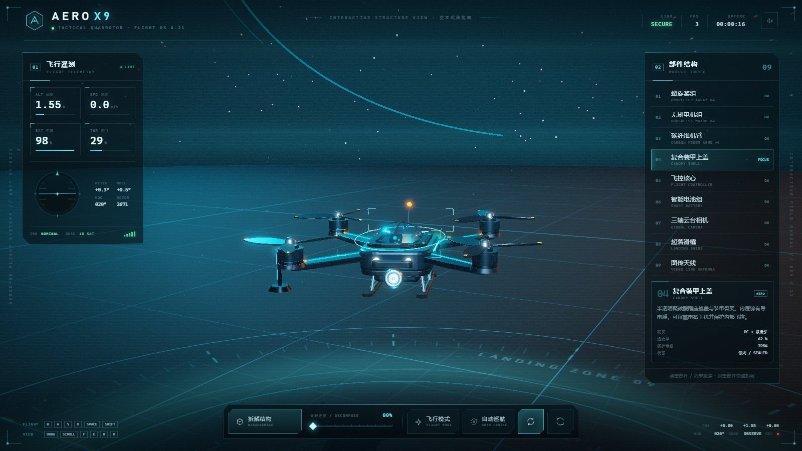
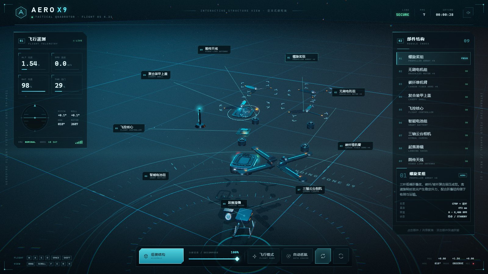
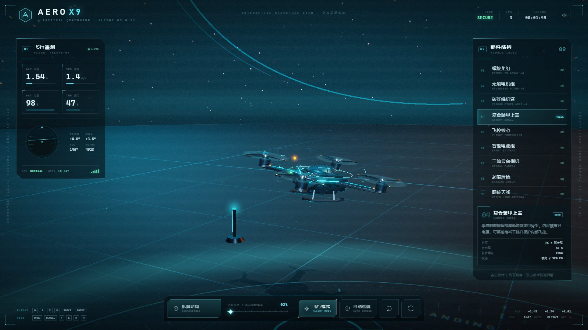
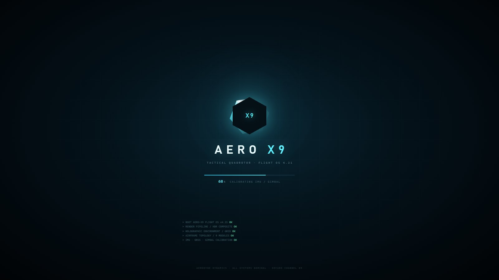

# AERO X-9 · 交互式 3D 无人机

> 程序化建模的四旋翼无人机 / 单文件 WebGL 网页 / 可拆解 · 可控制 · 科技风 HUD



AERO X-9 是一个完全由 Three.js 几何体程序化构建的交互式 3D 无人机演示。模型、场景、HUD、后期和音效全部打包进一个 `index.html`，双击即可离线运行，也可以直接部署到 GitHub Pages。

## 在线运行 / 本地运行

- **直接打开**：下载或克隆本仓库，双击 `index.html`（推荐 Chrome / Edge）。
- **GitHub Pages**：仓库 `Settings → Pages → Deploy from a branch`，选择 `main` 分支的 `/ (root)`，保存后访问 `https://<你的GitHub用户名>.github.io/<仓库名>/`。
- **完全离线**：Three.js 已内联，页面不发起任何外部请求。

## 功能

- **程序化机体**：机身、玻璃座舱、飞控板、智能电池、三轴云台相机、起落滑橇、图传天线、四组机臂 / 无刷电机 / 三叶桨，零外部模型资产。
- **结构拆解**：9 个模块分层展开，0–100% 滑杆、缓动动画、环形引线标签与部件参数卡。
- **可交互**：点击 3D 部件或右侧列表选中同步，悬停提示；轨道相机支持拖拽旋转 / 滚轮缩放 / 双击复位。
- **飞行控制**：`WASD` 相对镜头平移、`Space/Shift` 升降，机体自动压坡度与俯仰；支持自动回航、自动巡航、自动环绕。
- **科技风 HUD**：飞行遥测、姿态仪、模块索引、启动序列、扫描线、噪点、星空与全息停机坪。
- **自研后期**：HDR Bloom、ACES 色调映射、色差、暗角、颗粒，WebGL2 HalfFloat 渲染目标。
- **音效**：可选 WebAudio 电机 / 风噪合成音（默认静音）。

## 操作

| 操作 | 功能 |
| --- | --- |
| 鼠标左键拖拽 / 滚轮 / 双击空白 | 旋转视角 / 缩放 / 复位视角 |
| 点击 3D 部件 / 右侧列表 / `1`–`9` | 选中部件并查看参数 |
| `E` / 「拆解结构」 / 分解滑杆 | 拆解或组装 |
| `F` / 「飞行模式」 | 进入 / 退出飞行 |
| `W A S D` / `Space` / `Shift` | 前后左右 / 上升 / 下降 |
| 「自动巡航」 / 「自动环绕」 | 演示飞行 / 相机自动环绕 |
| `H` / `M` / `R` | 隐藏 HUD / 声音 / 复位视角 |

## 截图

| 首屏 | 结构拆解 |
| --- | --- |
|  |  |

| 飞行模式 | 启动画面 |
| --- | --- |
|  |  |

## 技术实现

- **Three.js r160**（UMD min 构建，内联；MIT）
- 模型全部由 `ExtrudeGeometry` / `CylinderGeometry` / `SphereGeometry` / `TubeGeometry` / 自定义 Shape 生成，无外部模型或贴图。
- 自研阻尼轨道相机（自动环绕、触摸双指缩放、平滑跟随）。
- 自研 HDR 后期管线：场景 → HalfFloat RT → bright pass → 3 mip Gaussian bloom → composite（ACES + 色差 + 暗角 + 颗粒 + 手动 sRGB）。
- 程序化环境贴图：Canvas 等距柱状图 → PMREM。
- WebAudio 合成音效；无外部字体、图片、CDN 或网络请求。

### 目录结构

```text
.
├─ index.html              # 最终单文件应用（可直接部署 / 双击）
├─ screenshots/            # README 截图（JPG）
├─ src/                    # 可维护源码
│  ├─ index.template.html  # HUD 结构 + CSS
│  ├─ core.js              # 工具、环境贴图、材质、几何辅助
│  ├─ postfx.js            # HDR Bloom 后期
│  ├─ scene.js             # 停机坪、星空、灯光、粒子
│  ├─ drone.js             # 无人机建模 / 部件 / 拆解 / 选中
│  ├─ controls.js          # 轨道相机
│  ├─ ui.js                # HUD 绑定、标签、启动序列
│  └─ main.js              # 装配、循环、飞行物理、交互
├─ tools/build.mjs         # 将 src + three 内联为单文件
├─ vendor/three.min.js     # Three.js r160（MIT）
├─ package.json
├─ THIRD_PARTY_NOTICES.md
└─ .gitignore
```

### 重新构建

无需安装依赖：

```bash
npm run build
# 等价于 node tools/build.mjs --out=index.html
```

构建脚本会把 `vendor/three.min.js` 与 `src/{core,postfx,scene,drone,controls,ui,main}.js` 依次内联进 `src/index.template.html`，生成根目录的 `index.html`。

## 质量验证

- 独立 QA 使用真实浏览器输入事件（鼠标拖拽 / 悬停 / 点击、键盘 `WASD` / `Space` / `Shift`、滑杆拖动）验证了：加载、拆解 / 组装、部件选择、相机、飞行、自动巡航、快捷键、响应式布局与 URL 参数兜底。
- 最终构建无未捕获异常、无 console error；`window.__ERRORS` 为空。
- 已知可选优化：HUD 小字号在低分屏上可再提高对比度；首屏机体可再放大；Bloom 局部高光可再收敛。

## 浏览器兼容

Chrome / Edge / Firefox 新版。WebGL2 下可获得最佳 HDR Bloom 效果；不支持时可访问 `?nofx=1` 关闭后期。窄屏（≤1120px / ≤820px）会自动隐藏侧栏并压缩 Dock。

## 演示参数

页面支持一些便于演示或调试的 URL 参数：

| 参数 | 作用 |
| --- | --- |
| `?explode=1` | 启动即完全拆解 |
| `?sel=props` | 启动选中指定部件 |
| `?mode=flight` | 启动即飞行模式 |
| `?cruise=1` | 启动自动巡航 |
| `?nofx=1` | 关闭后期（低配兜底） |
| `?ui=0` | 隐藏 HUD |
| `?camtheta=0.8&camphi=1.2&camradius=5` | 指定初始相机方位 / 俯仰 / 距离 |


## 隐私说明

- 本项目不包含任何统计、追踪、外部资源或网络请求，页面完全本地运行。
- 所有模型与界面均为程序化生成，仓库内截图不包含个人信息。
- 仓库不包含开发过程中的浏览器配置、测试日志或本地绝对路径。

## 第三方许可

Three.js r160，MIT License；详见 [THIRD_PARTY_NOTICES.md](THIRD_PARTY_NOTICES.md)。
